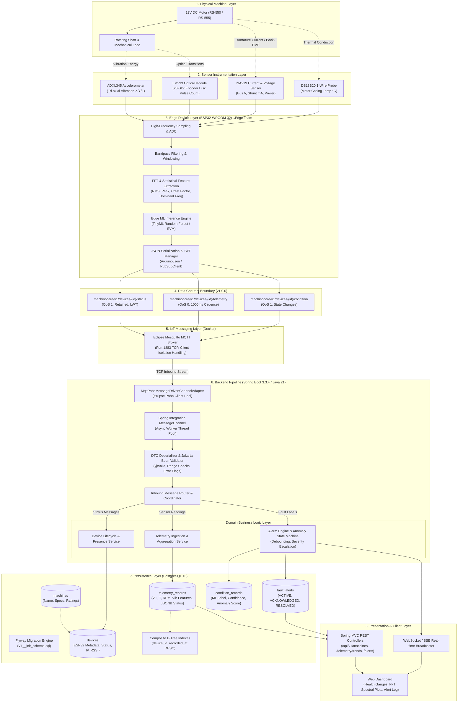

# MachinoCare: Edge-AI Multi-Sensor Condition Monitoring & Fault Diagnosis System

[](https://openjdk.org/)
[](https://spring.io/projects/spring-boot)
[](https://mosquitto.org/)
[](https://www.postgresql.org/)
[](https://www.docker.com/)

**MachinoCare** is an industrial condition-monitoring and predictive maintenance pipeline designed to detect electrical and mechanical degradation in **12V DC motors (RS-550 / RS-555)** in real time. Rather than relying on single-threshold alerts, MachinoCare correlates multi-sensor telemetry (vibration frequency spectra, electrical load, casing temperature, and rotational speed) with Edge-ML inference to diagnose root causes before catastrophic failure occurs.

---

## 1. Architectural Boundary & Team Ownership

MachinoCare enforces a strict, first-class contract boundary between hardware edge computing and enterprise cloud/backend infrastructure:

```text
========================================================================================
   EDGE COMPUTING PIPELINE (Edge Team)
   Sensors -> ESP32 Data Acquisition -> Signal Conditioning -> FFT & Features -> Edge ML
========================================================================================
                                           │
                                           │ MQTT over Wi-Fi
                                           ▼
========================================================================================
   FIRST-CLASS DATA CONTRACT BOUNDARY (Topics, JSON Schemas, Units, QoS, LWT)
   docs/contracts/edge-iot-data-contract.md
========================================================================================
                                           │
                                           ▼
========================================================================================
   IoT & BACKEND PIPELINE (My Scope)
   Broker -> Spring Integration -> Validation -> Domain Services -> PostgreSQL -> REST APIs -> Dashboard
========================================================================================
```

---

## 2. Comprehensive System Architecture

The following Mermaid diagram details the end-to-end data flow, execution threads, and infrastructure components across all layers:



---

## 3. Sensor Suite & Diagnostic Correlation

Multi-sensor correlation prevents false positives. For example, increased current alone might simply mean the motor is working harder under a normal workload, but **increased current paired with dropping RPM and rising temperature indicates mechanical binding or bearing overload**:

| Sensor | Physical Metric | Edge-Extracted Features | Diagnostic Relevance |
|---|---|---|---|
| **ADXL345** | Acceleration ($g$) | RMS, Peak, Crest Factor, Dominant Freq (FFT) | Structural looseness, rotor mass imbalance, bearing impact rattling |
| **INA219** | Bus Voltage ($V$), Current ($A$) | Voltage, Armature Current, Real Power ($W$) | Torque demand ($\text{Torque} \propto I$), electrical load spikes, stall warnings |
| **DS18B20** | Temperature ($^\circ\text{C}$) | Casing Surface Temperature | Long-term $I^2R$ thermal dissipation, cooling failure, friction heat |
| **LM393** | Shaft RPM (20-slot disc) | Rotational Speed (rev/min) | Back-EMF equilibrium ($\text{Back-EMF} \propto \text{Speed}$), slip detection |

### Diagnostic Condition Labels (Edge ML Output)
* **`NORMAL`**: Nominal electrical draw, stable operating temperature, low vibration RMS ($<0.4g$).
* **`IMBALANCE`**: 1X rotational harmonic spike in FFT, elevated vibration RMS ($>1.0g$), stable electrical load.
* **`LOOSE_MOUNTING`**: High Crest Factor ($>3.0$), impact sub-harmonics from mechanical rattling/chatter.
* **`LOAD_RELATED_ABNORMALITY`**: Increased mechanical resistance $\rightarrow$ RPM drops $\rightarrow$ Back-EMF drops $\rightarrow$ Current surges $\rightarrow$ Casing temperature climbs rapidly.

---

## 4. MQTT Topic Taxonomy & Quality of Service (QoS)

| Topic | QoS | Retained | Frequency | Payload Description |
|---|---|---|---|---|
| `machinocare/v1/devices/{deviceId}/status` | **1** | **true** | On connect / LWT | Device presence (`ONLINE`/`OFFLINE`), IP, Wi-Fi RSSI, LWT payload |
| `machinocare/v1/devices/{deviceId}/telemetry` | **0** | **false** | Periodic (1000 ms) | Time-series electrical, thermal, RPM, and vibration summary features |
| `machinocare/v1/devices/{deviceId}/condition` | **1** | **false** | On inference / event | ML condition label, statistical confidence, and anomaly score |

---

## 5. Technology Stack & Key Decisions

* **Language & Runtime:** Java 21 (LTS) — utilizing modern Records, pattern matching, and Virtual Threads capability.
* **Backend Framework:** Spring Boot 3.3.4 (Spring Web, Spring Integration MQTT, Spring Data JPA, Jakarta Bean Validation).
* **Messaging Broker:** Eclipse Mosquitto 2.0 (Containerized via Docker Compose).
* **Database & Migration:** PostgreSQL 16 (Alpine) with Flyway database migration versioning (`V1__init_schema.sql`).
* **Connection Pooling:** HikariCP for high-throughput, low-latency database connection reuse.
* **Edge Simulation:** Python 3.14 with `paho-mqtt` 2.1 for hardware-in-the-loop mocking and physics emulation.

---

## 6. Project Directory Structure

```text
MachinoCare - Predictive maintainance/
├── README.md                               <-- Master Project Documentation
├── .gitignore                              <-- Git exclusions (Maven, Python, IDE)
├── docs/
│   └── contracts/
│       └── edge-iot-data-contract.md       <-- Formal Data Contract Specification v1.0.0
├── docker/
│   ├── docker-compose.yml                  <-- Mosquitto (port 1883) & PostgreSQL (port 5432)
│   └── mosquitto/
│       └── config/
│           └── mosquitto.conf              <-- Broker configuration (listeners, logging)
├── backend/                                <-- Spring Boot 3 / Java 21 Service
│   ├── pom.xml                             <-- Maven dependencies and build plugins
│   └── src/
│       ├── main/
│       │   ├── java/com/machinocare/
│       │   │   └── MachinoCareApplication.java
│       │   └── resources/
│       │       └── application.yml         <-- Central externalized configuration
│       └── test/
└── simulator/                              <-- Edge Hardware Testing & Mock Tools
    ├── requirements.txt                    <-- Python dependencies (paho-mqtt)
    ├── edge_simulator.py                   <-- Physics-based RS-550 DC motor simulator
    └── live_listener.py                    <-- Real-time CLI MQTT packet sniffer
```

---

## 7. Quick Start & Local Execution

### 1. Start Infrastructure (Docker)
Ensure Docker Desktop is running, then execute:
```powershell
cd docker
docker compose up -d
```
*Verify both containers are running:*
```powershell
docker compose ps
```

### 2. Verify Ports
* **Mosquitto (MQTT):** `localhost:1883`
* **PostgreSQL:** `localhost:5432` (`POSTGRES_DB=machinocare`, `POSTGRES_USER=postgres`, `POSTGRES_PASSWORD=postgres`)

### 3. Run the Hardware Simulator / Packet Listener (Optional Testing)
* To monitor live MQTT traffic:
  ```powershell
  python simulator/live_listener.py
  ```
* To simulate motor physics and inject faults:
  ```powershell
  python simulator/edge_simulator.py --mode cycle
  ```

### 4. Build & Run the Backend
```powershell
cd backend
mvn clean compile
mvn spring-boot:run
```

---

## 8. Cross-Machine Hardware Testing Guide (Windows $\leftrightarrow$ Mac / ESP32)

When integrating with physical ESP32 hardware or cross-platform team laptops:
1. Connect both computers (Windows host and Mac/ESP32) to the **same Wi-Fi or Mobile Hotspot** (avoid university Wi-Fi with client isolation).
2. Obtain the host Windows Wi-Fi IP via `ipconfig`.
3. Allow incoming TCP traffic on port 1883 via Windows PowerShell (Admin):
   ```powershell
   New-NetFirewallRule -DisplayName "MachinoCare MQTT" -Direction Inbound -LocalPort 1883 -Protocol TCP -Action Allow
   ```
4. Configure the ESP32 firmware to point to the host Windows IP on port 1883 with buffer size set to `1024` bytes:
   ```cpp
   mqttClient.setServer(hostIp, 1883);
   mqttClient.setBufferSize(1024);
   ```
