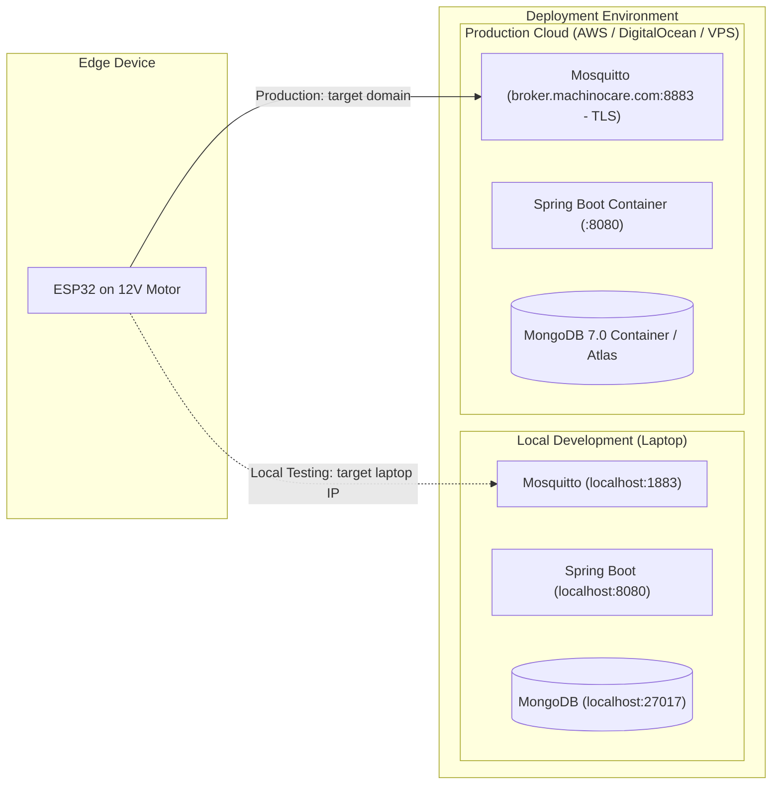

# MachinoCare: End-to-End System Architecture & Design Specification

[]()
[](https://mosquitto.org/)
[-brightgreen.svg)](https://spring.io/)
[](https://www.mongodb.com/)

---

## 1. Executive Summary

**MachinoCare** is a production-grade Edge-AI condition monitoring and predictive maintenance system tailored for a 12V DC motor (RS-550 / RS-555). The system continuously correlates electrical, thermal, optical rotational, and vibration spectral data to detect mechanical wear and electrical degradation before catastrophic hardware failure.

### Core Philosophy: Edge Intelligence + Industrial Cloud
- **Diagnosis happens at the Edge (ESP32)**: FFT frequency analysis, statistical feature extraction, and TinyML inference execute directly on the microcontroller to guarantee real-time sub-second fault detection.
- **Enterprise telemetry & persistence happens in the Backend (Spring Boot + MongoDB)**: High-speed ingestion, validation, anomaly alerting, time-series storage, and REST APIs are decoupled from the hardware via an MQTT message broker.

---

## 2. End-to-End Architecture Blueprint

```text
┌──────────────────────────────────────────────────────────────────────────────────┐
│                             1. PHYSICAL MACHINE LAYER                            │
│  12V DC Motor (RS-555 / RS-550) + 20-Slot Optical Encoder Disc on Drive Shaft    │
└────────────────────────────────────────┬─────────────────────────────────────────┘
                                         ▼
┌──────────────────────────────────────────────────────────────────────────────────┐
│                                2. SENSOR LAYER                                   │
│  • ADXL345  (SPI/I2C) : 3-Axis Acceleration & High-Frequency Vibration          │
│  • INA219   (I2C)     : Armature Bus Voltage (V) & Current Draw (A)             │
│  • DS18B20  (1-Wire)  : Casing Surface Temperature (°C)                         │
│  • LM393    (GPIO)    : Optical Interrupter Pulses for Shaft RPM                │
└────────────────────────────────────────┬─────────────────────────────────────────┘
                                         ▼
┌──────────────────────────────────────────────────────────────────────────────────┐
│                   3. EDGE DEVICE LAYER (ESP32-WROOM-32) - [EDGE TEAM]            │
│  3.1 Data Acquisition : Periodic multi-sensor ADC/SPI polling                    │
│  3.2 Signal Filtering : Rolling window, baseline offset removal, normalization   │
│  3.3 Feature Extract  : Vibration RMS, Peak, Crest Factor, FFT Dominant Freq     │
│  3.4 TinyML Inference : Lightweight Multi-Feature Classifier                     │
│      Classes          : NORMAL | IMBALANCE | LOOSE_MOUNTING | LOAD_ABNORMALITY   │
│  3.5 Payload Packing  : Contract-compliant JSON serialization                    │
└────────────────────────────────────────┬─────────────────────────────────────────┘
                                         │ Wi-Fi (MQTT Protocol)
                                         ▼
┌──────────────────────────────────────────────────────────────────────────────────┐
│              4. IoT / COMMUNICATION INGESTION LAYER - [MY RESPONSIBILITY]        │
│  • Eclipse Mosquitto 2.0 MQTT Broker                                             │
│  • Topics:                                                                       │
│      machinocare/v1/devices/{deviceId}/status     (QoS 1, Retained, LWT)        │
│      machinocare/v1/devices/{deviceId}/telemetry  (QoS 0, 1000ms periodic)      │
│      machinocare/v1/devices/{deviceId}/condition  (QoS 1, On-inference)         │
└────────────────────────────────────────┬─────────────────────────────────────────┘
                                         ▼
┌──────────────────────────────────────────────────────────────────────────────────┐
│                 5. BACKEND SERVICES LAYER (Spring Boot 3 / Java 21)              │
│  • Spring Integration MQTT Inbound Message Driven Channel Adapter                │
│  • JSR-380 Schema & Boundary Validation                                          │
│  • Device Presence & Last-Will Lifecycle Tracking                               │
│  • Multi-Level Fault Alert Engine & Debouncing                                  │
│  • RESTful Endpoints & Real-Time Push Feeds                                      │
└────────────────────────────────────────┬─────────────────────────────────────────┘
                                         ▼
┌──────────────────────────────────────────────────────────────────────────────────┐
│                     6. PERSISTENCE LAYER (MongoDB 7.0)                           │
│  • devices      : Hardware registry, Wi-Fi RSSI, IP, online/offline presence    │
│  • telemetry    : High-frequency time-series sensor features & physical units   │
│  • conditions   : AI diagnosis results, classification confidence, anomaly score │
│  • alerts       : Actionable maintenance events, severity, resolution history   │
└────────────────────────────────────────┬─────────────────────────────────────────┘
                                         ▼
┌──────────────────────────────────────────────────────────────────────────────────┐
│                     7. PRESENTATION LAYER (Web Dashboard)                        │
│  • Real-Time Vital Gauges : Current, Voltage, RPM, Temperature, Vibration RMS   │
│  • Health Status Indicator : Normal (Green) | Warning (Yellow) | Critical (Red)  │
│  • Fault Alert Cards       : Real-time notification with recommended action      │
│  • Historical Trends       : Multi-day degradation graphs & FFT spectrum view    │
└──────────────────────────────────────────────────────────────────────────────────┘
```

---

## 3. Key Architectural Decisions & Trade-Off Analysis

### 3.1 Why MQTT + Spring Boot + MongoDB instead of Firebase?

| Dimension | Pure Firebase Approach | MQTT + Spring Boot + MongoDB (MachinoCare) |
| :--- | :--- | :--- |
| **Microcontroller RAM Impact** | **Severe (~35–50 KB)**. Heavy SSL buffers and JSON overhead frequently trigger ESP32 FreeRTOS stack overflow or Watchdog timer resets. | **Negligible (~3 KB)**. Native binary socket protocol leaves >95% RAM free for FFT math and TinyML inference. |
| **Network Throughput & Rate Limits** | High latency (200–800 ms per HTTPS write). Cloud quota limits (e.g. 20k writes/day free) exhaust in ~5 hours at 1 Hz streaming. | Sub-10 ms latency. Handles >10,000 msg/sec without rate-limiting, entirely free and unconstrained. |
| **Hardware Disconnect Detection** | Unreliable. Requires complex client-side keepalive timeouts. | **Native LWT (Last Will & Testament)**. Broker detects unexpected power or Wi-Fi loss and immediately publishes an offline event. |
| **Architectural Separation** | Tightly couples physical hardware directly to Google proprietary cloud services. | Clean separation of concerns. Edge only knows MQTT; backend can be swapped, scaled, or migrated anywhere. |
| **Industry Standard & Rigor** | Viewed as a hobbyist or tutorial pattern. | Standard industrial IIoT architecture used by automotive and manufacturing leaders (Siemens, Bosch, Tesla). |

---

### 3.2 Why MongoDB 7.0 for Storage?

1. **Flexible Telemetry Schemas**: Sensor features change as models evolve (e.g., adding FFT frequency bins, temperature variance, or multi-axis vibration). MongoDB stores polymorphic JSON documents naturally without costly relational schema migrations.
2. **Compound Index Optimization**: High-frequency queries always filter by `(deviceId, timestamp)`. MongoDB compound b-tree indexes deliver sub-millisecond range queries across millions of records.
3. **Native Time-Series Support**: MongoDB provides automated bucket compression and TTL (Time-To-Live) indexing, optimizing disk storage for continuous high-rate sensor streams.

---

## 4. Deployment Architecture: Local to Production

A major strength of MachinoCare's design is **zero code changes between local testing and production cloud deployment**.



### What Changes Between Local and Production?

| Layer | Local Development | Production Cloud Deployment |
| :--- | :--- | :--- |
| **ESP32 Firmware** | `mqtt_server = "192.168.1.50"` (Port 1883) | `mqtt_server = "broker.machinocare.com"` (Port 8883 MQTTS) |
| **Mosquitto Broker** | Docker container, anonymous access enabled | Docker container, TLS/SSL certificates enabled, user/pass authentication |
| **Backend & Database** | `docker compose up -d` on local machine | `docker compose up -d` on Linux cloud instance (AWS EC2 / DigitalOcean) |
| **Dashboard Access** | `http://localhost:8080` | `https://machinocare.com` |

---

## 5. Team Responsibilities & Workflow

```text
┌──────────────────────────────────────────────┐    ┌──────────────────────────────────────────────┐
│          EDGE TEAM RESPONSIBILITY            │    │         BACKEND & IoT RESPONSIBILITY         │
│ • Sensor circuit wiring & bring-up           │    │ • MQTT Broker infrastructure & orchestration │
│ • Firmware sampling (SPI/I2C/1-Wire/GPIO)    │    │ • Spring Boot telemetry ingestion pipeline  │
│ • FFT signal processing & feature extraction │    │ • MongoDB time-series schema & repositories  │
│ • TinyML model training & C++ inference      │    │ • Alert thresholding & debouncing logic      │
│ • Wi-Fi connection & MQTT publishing         │    │ • REST APIs, WebSockets & Monitoring Web UI  │
└──────────────────────────────────────┬───────┘    └──────────────────────┬───────────────────────┘
                                       │                                   │
                                       └───────────────┬───────────────────┘
                                                       │
                                                       ▼
                                     ┌───────────────────────────────────┐
                                     │  FIRST-CLASS DATA CONTRACT v1.0   │
                                     │  docs/contracts/                  │
                                     │    edge-iot-data-contract.md      │
                                     └───────────────────────────────────┘
```
